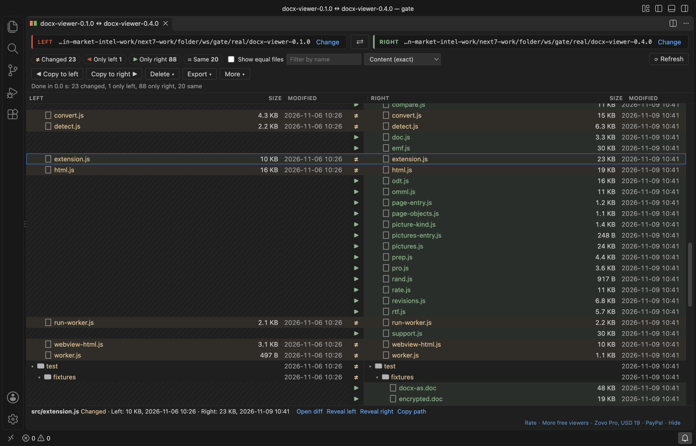
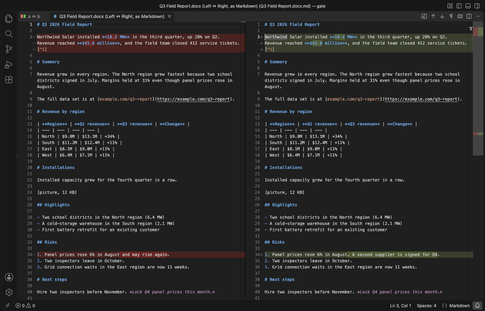
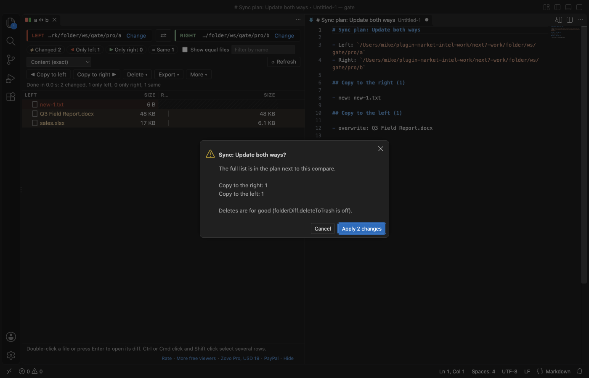

# Folder Compare & Folder Diff for VS Code

Compare two folders side by side, then open the diff of any file in them: code and text, Word, Excel, CSV, Parquet, PDF and binary files. A folder compare and directory diff tool that runs inside VS Code. Free, no sign-in, works offline.

Select two folders in the Explorer, right-click, and choose "Compare Selected Folders". The Left and Right panels show their full paths at the top of the view, so you always know which side is which.

## What it does

- Left and Right trees side by side, with the full path of each folder, size and modified time per file, and one status per row: changed, only left, only right, same, or error.
- Click a count to see only those rows. Equal files are hidden by default. Filter by name.
- The walk and the byte compare run in a background thread, with a progress bar and Cancel. Large trees stay responsive: 10,000 files per side finish in 1 to 2 seconds.
- Double-click a row to open the right diff for that kind of file:
  - text and code open in the VS Code diff editor, on the real files, so you can edit and save
  - `.docx`, `.doc` and `.odt` open as Markdown side by side
  - `.xlsx`, `.xls`, `.ods`, `.csv` and `.parquet` open as CSV rows, one section per sheet
  - `.pdf` opens as the text of every page
  - any other file (images, firmware, archives) shows hex lines around every range of bytes that differs, with a count
- Copy to right, Copy to left and Delete list every file first (new, overwritten, folder with N files). Nothing is written before you confirm. Deleted files go to the Trash by default.
- Export the result as Markdown, CSV or HTML.
- Compare a folder with a Git branch or tag: right-click a folder, then pick HEAD, a branch, a tag or a commit. Git runs locally with repository hooks turned off.
- Save a compare and open it again later (More, Save this compare; then "Open Saved Compare" in the Command Palette).

## Free and Zovo Pro

Everything above is free, with no limit and no sign-in. Three Zovo Pro tools in the More menu save time on bigger jobs. Each has 3 free tries on your computer, and a try counts only when the tool gives you a result: a sync that changed files, or a report on screen. Escape or Cancel never uses a try.

| Tool | Free | Zovo Pro |
|---|---|---|
| Compare folders, open any file diff, filters, copy, delete, export, Git compare, saved compares | yes | yes |
| Sync folders: update both ways (newer file wins) or mirror one side to the other, after a full plan of every copy and delete | 3 tries | yes |
| Report of document changes: one Markdown report of the text changes inside every changed Word, Excel, CSV, Parquet and PDF file | 3 tries | yes |
| Three-way compare and merge: a common base and two changed copies; conflicts are listed, one-sided changes merge into the base | 3 tries | yes |

Zovo Pro is USD 19 once and turns on the Pro tools in every Zovo extension. Pay by card, with GitHub Sponsors or with PayPal. Nothing about Pro shows when you open a compare; it only comes up when you click one of the three tools with no tries left. To hide the three tools, set `folderDiff.showProTools` to `false`.

## Safe with any folder

- Copy, sync and merge never write outside the folder you picked. A symbolic link on the target side is replaced, not written through, and a target folder that is a link to somewhere else is refused. Delete removes a link, never what it points to.
- Symbolic link loops are listed as links and never followed (unless you turn on `folderDiff.followSymlinks`, which detects loops).
- File names are shown as text: a name like `` or `$(touch x)` is just a name.
- Word and OpenDocument files that would unpack to more than 256 MB (zip bombs) are refused before anything is unpacked. Every converter runs in a separate thread with a memory cap and a time limit.
- No network calls and no telemetry. Files are read on your computer and never uploaded.

## Tested on

In real VS Code 1.142, with the packaged extension:

- two versions of a real project (132 files, nested folders): 23 changed, 1 only left, 88 only right, 20 same, equal to an independent byte check
- Word `.docx`, legacy `.doc`, OpenDocument `.odt`, Excel `.xlsx`, CSV, Parquet, PDF, PNG and a 2 MB firmware image: each opens its own diff
- 10,000 files per side with 100 changed, 50 removed and 30 added: exact counts, done in 1 to 2 seconds
- a 300 MB zip bomb named `.docx`, a cut `.xlsx` and random bytes named `.pdf`: each gives a message and the byte compare, and the next file opens normally
- symbolic links on the right side that point outside the folder: Copy replaces the link to a file and refuses the linked folder; the files outside stay unchanged
- file names with HTML, shell commands, right-to-left marks, emoji, NFC and NFD forms and 244 characters: all listed as plain text
- dark and light themes

## Settings

| Setting | Default | What it does |
|---|---|---|
| `folderDiff.compareMode` | `content` | `content` compares the bytes of files with the same size. `quick` uses size and modified time only. |
| `folderDiff.exclude` | `node_modules/`, `.git/`, `dist/`, `.DS_Store`, `Thumbs.db` | Names and globs to leave out. A trailing `/` matches folders only. |
| `folderDiff.useGitignore` | `true` | Also leave out what `.gitignore` files ignore. |
| `folderDiff.followSymlinks` | `false` | Off: a link is compared by its target. On: links are followed and loops are reported. |
| `folderDiff.showSame` | `false` | Show equal files when a compare opens. |
| `folderDiff.maxTextDiffMB` | `50` | Larger text files open in the byte compare. |
| `folderDiff.maxConvertMB` | `200` | Largest Word, Excel, Parquet or PDF file turned into text. |
| `folderDiff.deleteToTrash` | `true` | Delete moves files to the Trash. |
| `folderDiff.showProTools` | `true` | Show the three Zovo Pro tools in the More menu and the Command Palette. |
| `folderDiff.askForRating` | `true` | Ask once, after a few days of use, whether you want to rate the extension. Never after an error. |

## Privacy

The extension makes no network calls and has no telemetry. Files are read on your computer and never uploaded. Git runs locally, only for "Compare with Git Branch or Tag", and only in a trusted workspace.

## Limits

- Folders on this computer, or on the remote machine in a Remote window. Virtual file systems are not supported.
- Word, Excel and PDF files are compared by their text, not by layout or pictures.
- Copy keeps the modified time. File permissions and owners are not copied.

Works in VS Code 1.90 and later, Cursor, Windsurf and VSCodium.

## Support Zovo

Zovo Pro: USD 19 once, every Zovo viewer. [Get Zovo Pro on GitHub Sponsors](https://github.com/sponsors/theluckystrike/sponsorships?tier_id=679878) to turn on the Pro tools in this extension and in the other Zovo extensions you use. The free features stay free.

Zovo extensions have no ads and no tracking. They are made by [theluckystrike](https://github.com/theluckystrike) on GitHub. You can also support the work with no Pro:

- [Sponsor on GitHub](https://github.com/sponsors/theluckystrike)
- [PayPal](https://www.paypal.com/paypalme/najzzz)
- [Follow theluckystrike on GitHub](https://github.com/theluckystrike)

### Need your format supported?

Open a [format request](https://github.com/theluckystrike/folder-diff-vscode/issues/new?template=format-request.yml) with a sample file, and I reply there whether it can be done. For USD 299 once, through [this GitHub Sponsors tier](https://github.com/sponsors/theluckystrike/sponsorships?tier_id=679995), I add your file format or a missing feature to this extension, with tests, within 7 days.

## More tools by Zovo

- [Hex Viewer & Binary Viewer, Hex Editor (Large Files)](https://marketplace.visualstudio.com/items?itemName=zovo.zovo-hex-viewer) opens binary files of any size, with find, a data inspector and byte editing.
- [SVN Client & Subversion Source Control (Commit, Blame, Log, Diff)](https://marketplace.visualstudio.com/items?itemName=zovo.zovo-svn-client) brings SVN commit, diff, log and blame to the Source Control view.
- [ZIP Viewer & Archive Explorer (JAR, TAR, GZ)](https://marketplace.visualstudio.com/items?itemName=zovo.zip-archive-explorer) browses ZIP, JAR, VSIX, TAR and GZ files, opens entries in tabs and extracts them safely.
- [VCD Viewer & Waveform Viewer (Verilog, No Signal Limit)](https://marketplace.visualstudio.com/items?itemName=zovo.zovo-vcd-waveform-viewer) opens Verilog, SystemVerilog and VHDL VCD waveforms with no signal limit.
- [Linker Map Viewer & Map File Analyzer (GNU ld, Memory Usage)](https://marketplace.visualstudio.com/items?itemName=zovo.zovo-linker-map-viewer) shows FLASH and RAM use from GNU ld, lld, IAR and Keil map files.

See [all Zovo extensions on the Marketplace](https://marketplace.visualstudio.com/publishers/zovo).
