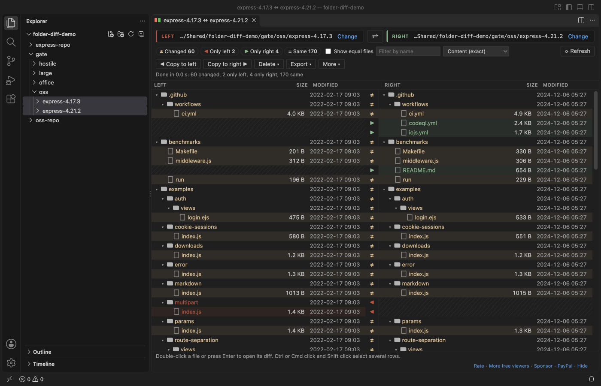
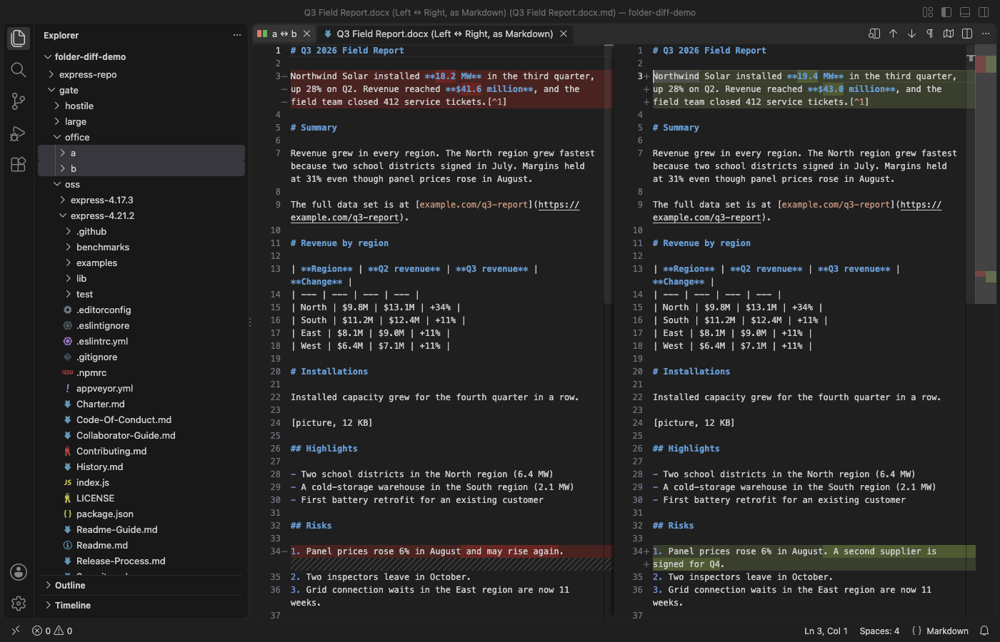
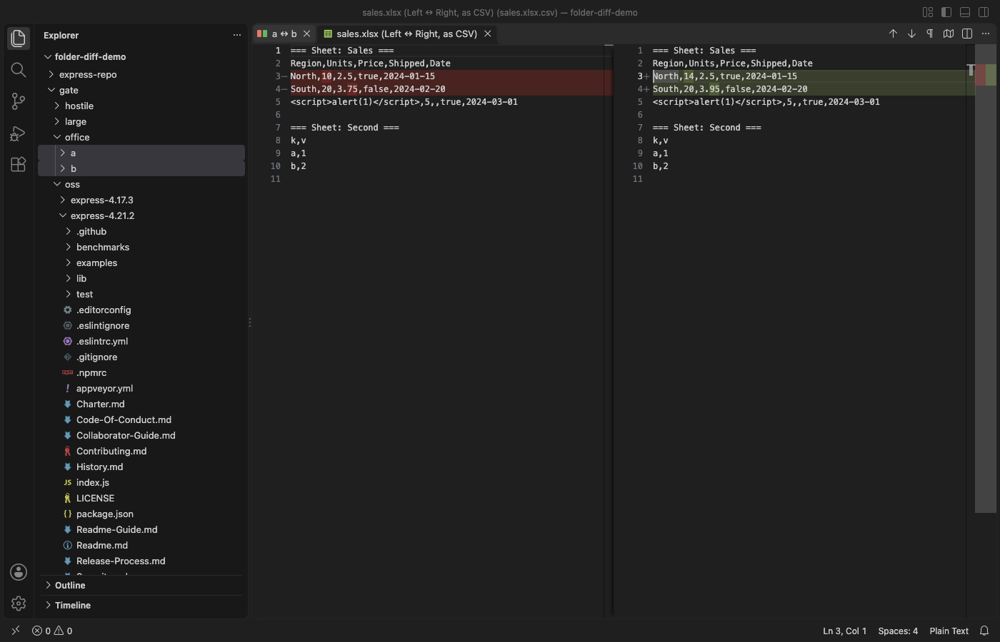
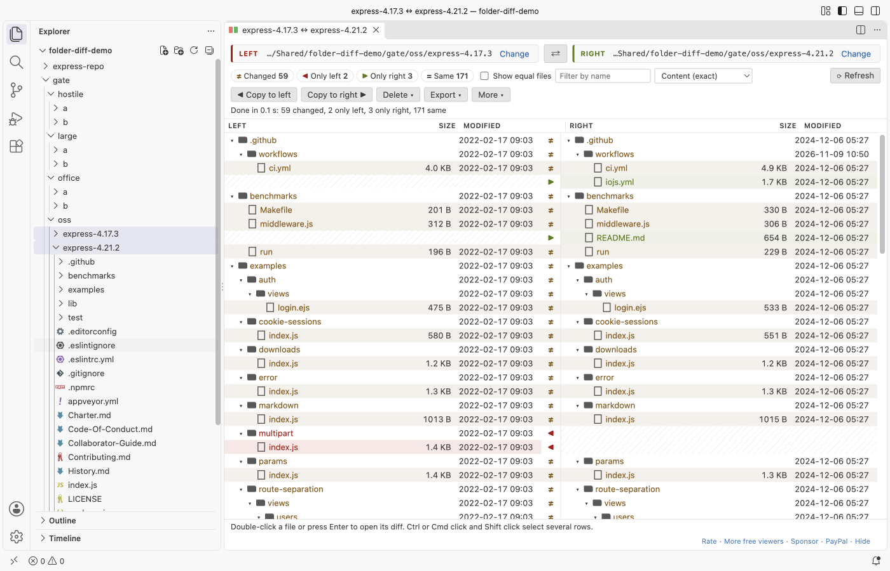
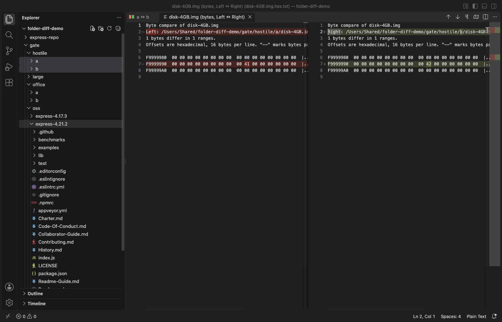

# Folder Compare & Directory Diff for VS Code

Compare two folders side by side, then open the diff of any file in them: code and text, Word, Excel, CSV, Parquet, PDF and binary files. Free, no sign-in, works offline.

Select two folders in the Explorer, right-click, and choose "Compare Selected Folders". The Left and Right panels show their full paths at the top of the view, so you always know which side is which.

## What it does

- Left and Right trees side by side, with the full path of each folder, size and modified time per file, and one status per row: changed, only left, only right, same, or error.
- Click a count to see only those rows. Equal files are hidden by default. Filter by name.
- The walk and the byte compare run in a background thread, with a progress bar and Cancel. 100,000 files per side: the tree shows in about 7 seconds, every file is checked in about 35 seconds, and the view keeps answering the whole time.
- Double-click a row to open the right diff for that kind of file:
  - text and code open in the VS Code diff editor, on the real files, so you can edit and save
  - `.docx`, `.doc` and `.odt` open as Markdown side by side
  - `.xlsx`, `.xls`, `.ods`, `.csv` and `.parquet` open as CSV rows, one section per sheet
  - `.pdf` opens as the text of every page
  - any other file (images, firmware, archives) shows hex lines around every range of bytes that differs, with a count. This works on 4 GB files.
- Copy to right, Copy to left and Delete list every file first (new, overwritten, folder with N files). Nothing is written before you confirm. Deleted files go to the Trash by default.
- Export the result as Markdown, CSV or HTML.
- Compare a folder with a Git branch or tag: right-click a folder, then pick HEAD, a branch, a tag or a commit. Git runs locally with repository hooks turned off.
- The More menu has folder sync after a preview plan, a report of the text changes in every changed Word, Excel and PDF file, three-way compare and merge, and saved compares.

## Why this one

These are complaints from reviews and issues of other folder compare extensions, and what this extension does about each one. The numbers come from our test run in VS Code on real folders (listed below).

| Complaint | Where | What this extension does |
|---|---|---|
| "At least identify which panel belongs to what source code" | [review, 22 Jul 2025](https://marketplace.visualstudio.com/items?itemName=moshfeu.compare-folders&ssr=false#review-details) | Left and Right panels, each with its full folder path in the header and its own size and date columns. |
| "All I would like to see is 2 panels with each selected dir and the differences highlighted, clicking on one of them should give options to copy/replace" | [review, 24 Dec 2023](https://marketplace.visualstudio.com/items?itemName=moshfeu.compare-folders&ssr=false#review-details) | The same: two panels, colored rows, double-click for the diff, Copy to left or right after a list of the files. |
| "The left toolbar UI does not respond to folder addition ... a never ending Compare folders message without any progress" | [review, 30 Oct 2025](https://marketplace.visualstudio.com/items?itemName=moshfeu.compare-folders&ssr=false#review-details), issues [#142](https://github.com/moshfeu/vscode-compare-folders/issues/142) and [#95](https://github.com/moshfeu/vscode-compare-folders/issues/95) | Start from the Explorer menu on two selected folders. A progress line counts entries and bytes, with Cancel. On 100,000 files per side the view answered within 120 ms during the whole run. |
| "Maximum call stack size exceeded" while comparing | about 30 issues, for example [#221](https://github.com/moshfeu/vscode-compare-folders/issues/221), [#200](https://github.com/moshfeu/vscode-compare-folders/issues/200), [#174](https://github.com/moshfeu/vscode-compare-folders/issues/174) | Files are compared as bytes in 1 MB steps, never split into lines. A 4 GB pair, a 64 MB random file and a 2 MB firmware image compared without an error. |
| "Useless without Beyond Compare installed on your computer" | [review, 10 Jan 2025](https://marketplace.visualstudio.com/items?itemName=ScooterSoftware.bcompare-vscode&ssr=false#review-details) | Nothing else to install. The Word, Excel, PDF and byte compare are inside this extension. |

## Tested on

In VS Code, with the packaged extension, on 10+ real file sets:

- two tags of the Express web framework (4.17.3 and 4.21.2): 236 file paths, counts checked against an independent byte compare
- Word `.docx`, legacy `.doc`, OpenDocument `.odt`, Excel `.xlsx`, CSV, Parquet, two PDFs, a PNG and a 2 MB firmware image
- 100,000 files per side, with 500 changed, 500 removed and 300 added: all counts exact
- hostile input: symbolic link loops, a file and a folder without read permission, the same name in Unicode NFC and NFD, a case-only rename, 4 GB sparse files, and a file that another program wrote to during the compare. Each gives a status and a note, not a crash.
- a folder against a Git tag
- dark and light themes

## Settings

| Setting | Default | What it does |
|---|---|---|
| `folderDiff.compareMode` | `content` | `content` compares the bytes of files with the same size. `quick` uses size and modified time only. |
| `folderDiff.exclude` | `node_modules/`, `.git/`, `dist/`, `.DS_Store`, `Thumbs.db` | Names and globs to leave out. A trailing `/` matches folders only. |
| `folderDiff.useGitignore` | `true` | Also leave out what `.gitignore` files ignore. |
| `folderDiff.followSymlinks` | `false` | Off: a link is compared by its target. On: links are followed and loops are reported. |
| `folderDiff.showSame` | `false` | Show equal files when a compare opens. |
| `folderDiff.maxTextDiffMB` | `50` | Larger text files open in the byte compare. |
| `folderDiff.maxConvertMB` | `200` | Largest Word, Excel, Parquet or PDF file turned into text. |
| `folderDiff.deleteToTrash` | `true` | Delete moves files to the Trash. |

## Privacy

The extension makes no network calls and has no telemetry. Files are read on your computer and never uploaded. Git runs locally, only for "Compare with Git Branch or Tag", and only in a trusted workspace.

## Limits

- Folders on this computer, or on the remote machine in a Remote window. Virtual file systems are not supported.
- Word, Excel and PDF files are compared by their text, not by layout or pictures.
- Copy keeps the modified time. File permissions and owners are not copied.

## Support Zovo

Zovo extensions are free, with no ads and no tracking. They are made by [theluckystrike](https://github.com/theluckystrike) on GitHub. If this one saves you time, you can support the work:

- [Sponsor on GitHub](https://github.com/sponsors/theluckystrike)
- [PayPal](https://www.paypal.com/paypalme/najzzz)
- [Follow theluckystrike on GitHub](https://github.com/theluckystrike)

## More tools by Zovo

- [ZIP Viewer & Archive Explorer (JAR, TAR, GZ)](https://marketplace.visualstudio.com/items?itemName=zovo.zip-archive-explorer) browses ZIP, JAR, VSIX, TAR and GZ files, opens entries in tabs and extracts them safely.
- [Hex Viewer & Binary Viewer, Hex Editor (Large Files)](https://marketplace.visualstudio.com/items?itemName=zovo.zovo-hex-viewer) Hex viewer, binary viewer and hex editor for VS Code that opens files of any size (4 GB and more) in under a second. Insert and delete bytes, compare two files byte by byte, go to offset, find hex or text, a data inspector, copy as C array or base64. Free, works offline.
- [PDF Viewer & Reader to Read and View PDF in Dark Mode](https://marketplace.visualstudio.com/items?itemName=zovo.pdf-viewer-dark) reads PDFs with a real dark mode, search, an outline and thumbnails.
- [XLSX Viewer & CSV Preview for Excel, XLS & Parquet](https://marketplace.visualstudio.com/items?itemName=zovo.table-viewer-vscode) opens CSV, TSV, Excel and Parquet files as a sortable, filterable table.
- [DOCX Viewer & ODT Viewer, Word Document Preview (Dark Mode)](https://marketplace.visualstudio.com/items?itemName=zovo.docx-viewer-vscode) previews Word and ODT files with dark mode, an outline and search.

See [all Zovo extensions on the Marketplace](https://marketplace.visualstudio.com/publishers/zovo).
